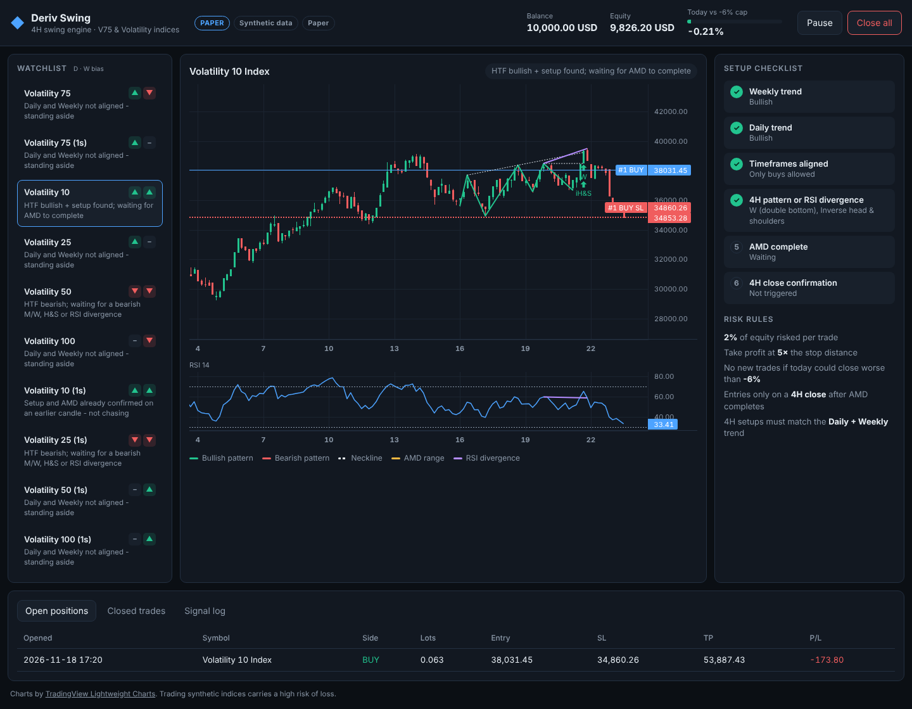

# VOBA-ASSETS · Deriv Swing

A fully automatic **4H swing-trading engine** for Deriv's **Volatility 75** and other Volatility indices on
**Deriv MT5**, with a web dashboard you can open from your phone or PC.

Think of it as an airline crew:

- The **Python engine** is the pilot. Every time a 4H candle closes, it checks each index against the flight plan
  (the strategy) and acts when every item on the checklist passes.
- **MetaTrader 5** is the plane's engines. Orders go through the MT5 terminal on the same Windows VPS.
- The **dashboard** is the cockpit window. You can see what the pilot sees, and you have the big red
  *Close all* lever.



---

## The strategy

A setup is only taken when **all** of these are true on the latest *closed* 4H candle:

| # | Check | Detail |
|---|-------|--------|
| 1 | **Daily trend** sets the direction | Price above the 50 EMA without a lower-high + lower-low structure (bullish), or the mirror image (bearish). |
| 2 | **Weekly trend** not against it | Same test on the Weekly. It may agree or be flat, but not point the other way. Set `strategy.htf.weekly: agree` to require full agreement. |
| 3 | **4H setup** in that direction | **M** (double top) / **W** (double bottom), **head & shoulders** / inverse H&S with a close through the neckline, **or** regular **RSI(14) divergence**. May be up to 5 days old (`setup_window: 30` candles). |
| 4 | **AMD complete** | **A**ccumulation: a tight 4H range. **M**anipulation: a wick sweeps one side of the range and the candle closes back inside (a stop hunt). **D**istribution: a 4H candle *closes* beyond the opposite side. |
| 5 | **4H close confirmation** | The candle that just closed must be the AMD break or the pattern's neckline break. The engine never chases a setup that confirmed earlier. |

AMD works like a spring: price coils (accumulation), gets pushed the wrong way to grab stops (manipulation),
then releases (distribution). Buying the release *after* the fake-out means the stop goes beyond the fake-out's
extreme, the point that would prove the idea wrong.

**Stop loss:** beyond the AMD sweep extreme. If a pattern was part of the setup, the stop also clears the
pattern's invalidation point (the right shoulder or the M/W peak). A small ATR buffer is added.
**Take profit:** 5 × the stop distance (1:5).

### Picking the best 2 a week

Every setup that passes the checklist gets a **quality score from 0 to 100**:

| Points | For |
|---|---|
| 20 (5 if flat) | Weekly trend agrees with the Daily |
| up to 40 | Confluence: M/W or H&S (+20, +5 for a second pattern), RSI divergence (+15) |
| up to 15 | How tight the AMD range was (a tighter coil is a cleaner spring) |
| 5 | The AMD break candle closed well beyond the range |
| 10 | Pattern and AMD confirmed on the same candle |
| up to 10 | A sensible stop size (≤3 ATR full points, 8 ATR or more none) |

The bot **auto-trades only setups scoring at least `selection.min_score` (60), and at most
`selection.max_trades_per_week` (2)** per Monday–Sunday UTC week. Everything else is logged as **watch** and
sent as a 👀 WhatsApp alert, so you can still look at it yourself.

The live bot can't wait until Sunday to see which 2 setups were best, because the entry has to happen at the 4H
close. It works like an interviewer who must decide on each candidate on the spot: you set the bar using past
candidates, then the bot takes the first 2 that clear it. **Set the bar from the backtest** (next section).

### Calibrating on real Deriv data

```bat
python -m deriv_swing.backtest --mt5 --bars 6000
```

The report shows how many trades a week each score bar would give, and whether higher scores really performed
better:

```
Score bar -> trades taken (with the weekly limit and one trade per symbol):
  bar    /week  trades    win%   avg R   total R
   50+     0.71      42    23.8%    +0.55     +23.0
   60+     0.45      27    33.3%    +1.19     +32.0
...
Every candidate by score (does a higher score really mean better trades?):
  score   count    win%   avg R
   50-59      26    19.2%    +0.27
   60-69      30    30.0%    +1.10
```

(These numbers came from the practice data and mean nothing. Use your own.) Pick the bar that gives the number of
trades a week you want with acceptable results, set `selection.min_score`, and check it again with `--min-score`.
If higher scores *don't* do better on real data, the score weights in `strategy.py` (`score_signal`) need changing
before you rely on them.

**More setups per week** needs a wider net, and each step also lets in lower-quality trades:
`strategy.setup_window` (how many 4H candles ago a pattern may be: now 30 = 5 days),
`strategy.amd.max_range_atr` (looser accumulation ranges), or a lower `min_score`.

## Risk management

| Rule | Setting |
|---|---|
| Risk per trade | **2%** of equity. Lot size is calculated from the stop distance and the symbol's tick value, always **rounded down**. |
| Reward : risk | **1 : 5** |
| Break-even | Once price is **2R** in profit, the stop moves to the entry price, so from then on the trade can't lose. That also frees its risk from the daily cap, so the bot can take another setup. Settings are under `risk.breakeven` (`trigger_r`, `lock_r`, `enabled`). |
| Daily loss cap | **−6%**. A trade is refused if *today's loss + the risk on all open trades + this trade* could exceed 6%. In practice that means at most three full-risk trades at a time and no revenge trading after a bad day. |
| Too-big minimum lot | If the broker's minimum lot would risk more than 2%, the trade is skipped, never forced. |
| Duplicates | Each AMD setup trades once (it is logged in `state/.../journal.sqlite`). |
| Kill switch | **Close all** in the dashboard closes every bot position and pauses the engine. |

What 2% at 1:5 means in numbers:
- You break even at a **16.7% win rate** (1 winner pays for 5 losers).
- **10 losses in a row** cost about **18%** of the account, and losing streaks of that length *will* happen with a low-win-rate system.
- Each winner adds about **+10%**.

The bot only manages positions that carry its own `magic` number, so manual trades on the same account are left alone.

---

Break-even works like a seatbelt you click on halfway through the journey. You give up some trades that would
have dipped back and then gone on to 5R, in exchange for never losing on a trade that already ran 2R your way.
Run `python -m deriv_swing.backtest --mt5` and the same command with `--no-breakeven` to see which suits these
indices better.

## WhatsApp alerts

Alerts come through Meta's official **WhatsApp Cloud API**. You get a message when:

| Event | Example |
|---|---|
| Trade opened | 🟢 BUY Volatility 75 Index · Entry … · SL … · TP … · lots, $ risk, and why |
| Stop moved to break-even | 🛡️ Break-even #12 · price reached 2R; stop moved to entry |
| Trade closed | 🏆 Take profit hit +5.0R · ⚪ Closed at break-even +0.0R · ❌ Stop loss hit −1.0R |
| Daily cap hit | 🛑 No new trades until tomorrow (UTC) |
| Engine started / symbol errors | 🚀 / ⚠️ |
| Signal refused (optional) | ⏭️ Set `notify_rejections: true` |

**The one rule to know:** WhatsApp won't let a business number message you first with free text. Every alert has
to use a **template** that Meta approves once, like a pre-printed form where the bot only fills in the blank. The
bot uses one template with a single blank (`{{1}}`) and puts each alert in it as one line, with parts separated by `·`.

### Setup (about an hour, mostly waiting for approval)

1. **Create the app.** Go to <https://developers.facebook.com/apps>, choose **Create app**, then the
   *Business* type (or the "Connect with customers through WhatsApp" use case), and add the **WhatsApp**
   product. Meta gives you a free **test business number**.
2. **Add yourself as a recipient.** In *WhatsApp → API Setup*, add your own WhatsApp number in the **To** list
   and enter the code Meta sends you. The test number can message up to 5 verified numbers.
3. **Check the connection.** Copy the **temporary access token** and the **Phone number ID** (a long number,
   *not* the phone number itself) from API Setup into `config.yaml`:
   ```yaml
   whatsapp:
     enabled: true
     access_token: "EAAG..."
     phone_number_id: "1234567890"
     to: ["27820000000"]        # your number: country code, no + or spaces
   ```
   Run `python -m deriv_swing.notify --hello`. You should receive Meta's "Hello World" message.
4. **Create the alert template.** In *WhatsApp Manager → Message templates → Create template*:
   - Category **Utility**, name `trade_alert`, language **English** (code `en`)
   - Body: `Deriv Swing alert: {{1}}. Sent by your trading bot.`
   - Sample for `{{1}}`: `BUY Volatility 75 Index · Entry 401250.00 · SL 395100.00 · TP 432000.00`

   Submit it. Approval usually takes minutes to a few hours. Meta rejects bodies that start or end with the blank,
   which is why the template has words on both sides.
5. **Get a permanent token.** The temporary token expires after 24 hours. In *Business Settings → Users →
   System users*, add a system user (Admin), assign it your app and WhatsApp account, then **Generate token** with
   the `whatsapp_business_messaging` and `whatsapp_business_management` permissions and expiry **Never**. Put
   it in `access_token`.
6. Run `python -m deriv_swing.notify --test`. You should get "Deriv Swing alert: ✅ test alert, WhatsApp is connected."

**Cost:** Meta charges a small fee per template message, depending on your country (see Meta's WhatsApp pricing
page). This bot sends only a few messages a day. To use your own number instead of the test number, register it
in WhatsApp Manager and add a payment method.

The token stays in `config.yaml`, which git ignores. Alerts are sent in the background, so if WhatsApp is slow or
down the bot keeps trading; failed sends are logged with Meta's reason (for example "template not approved"
or "recipient not in allowed list").

## Install on a Windows VPS

1. Rent a Windows VPS (any provider; 2 GB RAM is enough). Install **Deriv MT5** and **Python 3.11+** (tick
   "Add to PATH").
2. Log into your **Deriv MT5 demo** account in the terminal. In *Tools → Options → Expert Advisors*, enable
   **Algo Trading**.
3. Get the code and install:
   ```bat
   git clone https://github.com/voctormu/voba-assets.git
   cd voba-assets
   pip install -r requirements.txt
   copy config.example.yaml config.yaml
   ```
4. Edit `config.yaml`: fill in `mt5.login`, `mt5.password` and `mt5.server`, and set `data_source: mt5`.
5. Run it:
   ```bat
   python run.py
   ```
   Then open <http://127.0.0.1:8075> in the VPS browser.

**Viewing the dashboard from your phone:** set `dashboard.host: 0.0.0.0` **and** a long random
`dashboard.token` (the app refuses to start without one), and open port 8075 in the VPS firewall. The page asks
for the token once.

## Go live in stages

| Stage | `data_source` | `execution` | MT5 login | What you're checking |
|---|---|---|---|---|
| 0. Try the app anywhere | `synthetic` | `paper` | – | The dashboard works. Time runs 1,440× faster, so a 4H candle closes every 10 s. |
| 1. Backtest | – | – | any | `python -m deriv_swing.backtest --mt5 --bars 6000` replays the exact live rules over real Deriv history. |
| 2. Paper on real prices | `mt5` | `paper` | any | Signals on real candles; fills are simulated locally. |
| 3. Demo account | `mt5` | `mt5` | **Deriv-Demo** | Real orders, lot sizing and SL/TP on a demo account. |
| 4. Live | `mt5` | `mt5` | real | Only after stages 1–3 look right to you. |

**Be honest with yourself at stage 1.** Deriv's Volatility indices are generated by a random number generator
with constant volatility, so chart patterns have no guaranteed edge on them. The backtest is how you find out
whether this rule set holds up on real Deriv data before you risk money. Every threshold is in `config.yaml`
(`strategy:` section) so you can test variations.

## Project layout

```
run.py                      start engine + dashboard
config.example.yaml         every setting, documented
deriv_swing/
  swings.py                 swing highs/lows (the raw material for every pattern)
  patterns.py               M / W / head & shoulders / inverse H&S
  divergence.py             regular RSI divergence
  amd.py                    accumulation -> manipulation -> distribution
  structure.py              Daily / Weekly trend
  strategy.py               the checklist above -> Signal
  risk.py                   lot sizing, daily loss cap
  engine.py                 the loop: new 4H close -> analyse -> risk checks -> order
  broker.py                 PaperBroker and MT5Broker
  data.py                   MT5 candles, or a synthetic feed for testing
  journal.py                SQLite log of every signal and why it was taken or refused
  notify.py                 WhatsApp alerts (+ --hello / --test helpers)
  backtest.py               bar-by-bar replay of the live rules
  server.py, static/        FastAPI + dashboard (TradingView Lightweight Charts, bundled)
tests/                      pytest: detectors on hand-built charts, sizing, cap, engine, API
```

Run the tests with `pip install -r requirements-dev.txt && python -m pytest`.

## Limitations

- Paper mode checks SL/TP at each poll (every 30 s), not on every tick, so paper fills are approximate.
- The backtest assumes the stop is hit first when one candle touches both SL and TP. It doesn't model spread
  or the daily cap, so treat its results as optimistic.
- Beyond the single break-even move, the bot does not trail stops or take partial profits.
- The backtest moves the stop to break-even from the candle *after* the one that reached 2R, because 4H
  candles don't show whether the high or the low came first.

Charts use [TradingView Lightweight Charts](https://www.tradingview.com/lightweight-charts/) (Apache 2.0).
Trading synthetic indices carries a high risk of loss. This software is a tool, not financial advice.
